# micro-skater: teaching a tiny robot to skateboard with RL

<p align="center">
  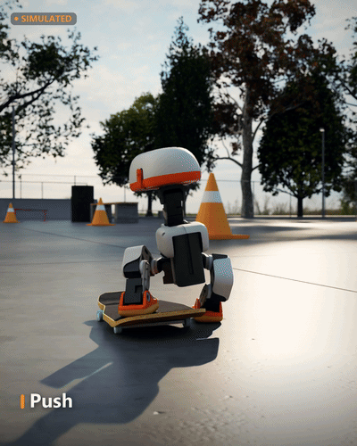
</p>

<p align="center"><i>Everything here is <b>simulation</b>: MuJoCo physics, with the videos replayed in Isaac Sim.
It has <b>not</b> run on the real robot.</i></p>

**micro-skater** teaches [Microduck](https://github.com/pollen-robotics/microduck_rl) to ride a skateboard with **reinforcement learning** (RL): trial and error
against a reward. Microduck is a 0.8 kg, 25 cm biped with 14 hobby servos. The project went
**walk → run → ride a board → one continuous run**:

**push off → manual (ride on the back wheels) → half-pipe → push with one foot between the walls.**

**Four specialist policies** do that run, one per phase, with a hand-written scheduler handing over. This repo has
their training tasks, checkpoints and evaluation, plus an honest account of what worked.

| Full run, real time (40 s, with bloopers) | Cinematic cut (50 s: slow motion and a 3× speed-up are labelled, with bloopers) |
|---|---|
| [▶ full_run_standard_4x5.mp4](media/full_run_standard_4x5.mp4) | [▶ full_run_cinematic_4x5.mp4](media/full_run_cinematic_4x5.mp4) |

## The journey

| Walk | Run | Step on | Push and ride | Carve | Step off |
|---|---|---|---|---|---|
| 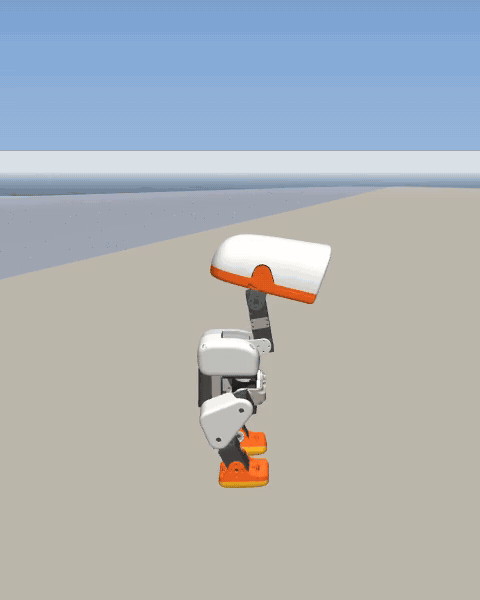 | 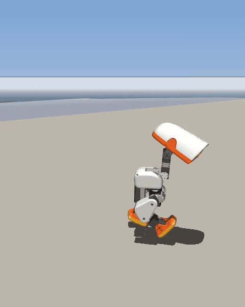 | 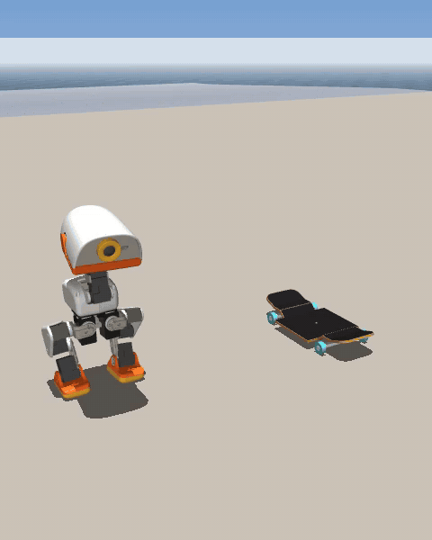 | 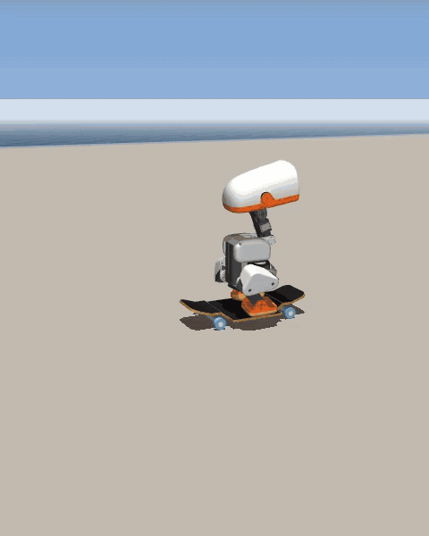 | 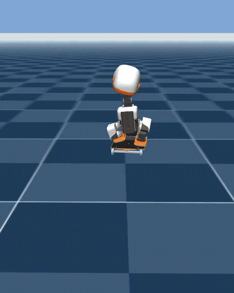 | 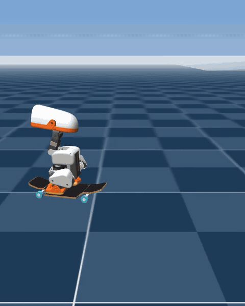 |

1. **Walk.** The walking policy was trained with microduck_rl's stock velocity task, unchanged.
2. **Run.** A run task added a narrow speed reward for fast commands. It reached about 0.73 m/s at a 0.8 m/s command.
3. **A keyboard-driven skater** (v1 → v7f): walk up, step on, push, steer, step off. Lesson: a glide must pay more
   than pushing, or the robot paddles forever.
4. **Tricks, then the four-phase run.** A trick policy on a wider double-kick board warm-started the run (its
   trained network was the starting point, not a random one). The run rides a 21 cm fishtail board.

More, including the walking and running rewards: [docs/early_phases.md](docs/early_phases.md).

## The four phases

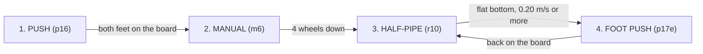

| Phase | What the robot does | Clip |
|---|---|---|
| **Push** | Starts with one foot on the board, kicks about 3 times to ~1 m/s, steps on | 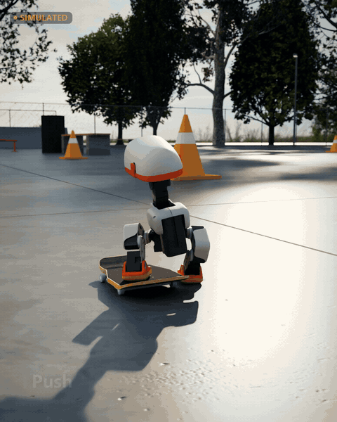 |
| **Manual** | Nose up 9–14° on the back wheels for ~2 s, then sets it down | 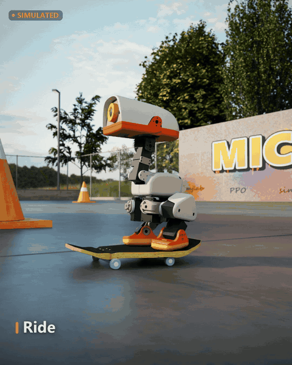 |
| **Half-pipe** | Carves into a mini half-pipe (8 cm walls) and rides the walls | 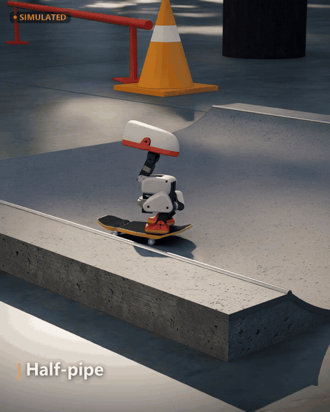 |
| **Foot push** | One push off the flat bottom to win back speed, then back on | 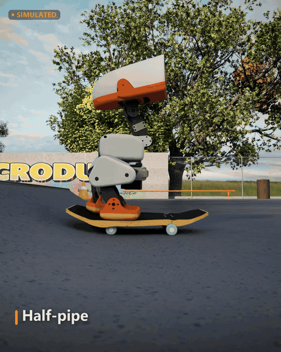<br><sub>0.25× slow motion</sub> |

## How the learning works

- **Simulator:** [MuJoCo](https://mujoco.org/) on the GPU through [mjlab](https://github.com/mujocolab/mjlab). 2048
  copies of the robot practise in parallel for the phase policies (4096 for the runner and skater).
- **Algorithm:** PPO ([rsl_rl](https://github.com/leggedrobotics/rsl_rl)): it nudges the network toward actions that
  scored better than expected, never too far in one step.
- **Policy:** a small neural network (512-256-128). Fifty times a second it reads **114 numbers** and outputs **14 servo
  targets**.
- **Inputs:** the robot's own sensors (IMU, joint angles and speeds), board and half-pipe state, and the phase. The
  board and pipe state are **privileged**: the real robot can't measure them.
- **Same input/output format in every phase**, so any policy can take over mid-run.

| What training sees (MuJoCo) | Manual | Half-pipe |
|---|---|---|
| 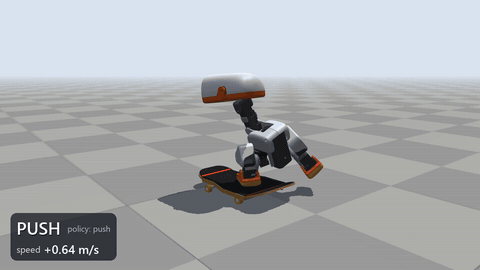 | 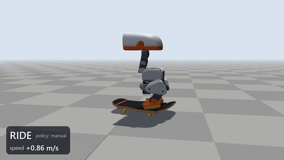 | 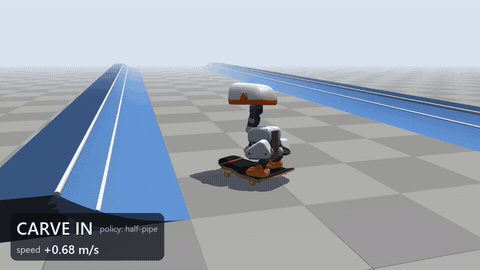 |

## Rewards in one table

A reward is a sum of **terms**: rewards (+) for what we want and costs (−) for what we don't. Most terms were added
after the policy **cheated** in a specific way.

| Phase | Main rewards (+) | Main costs (−) | A cheat that shaped it |
|---|---|---|---|
| All | upright, on the deck, clean riding | falling (−10), jerky actions, joint limits, **servo heat** | — |
| Push | speed from real kicks; a one-time step-on bonus | waiting, tapping, high "chicken kicks", head swinging | a per-step step-on reward was farmed by tapping on and off |
| Manual | nose up, best at 11–13°, held still; a one-time "hold complete" | speed loss, snapping the nose up, going above 14° | a 3–4° "hover" got almost full pay |
| Half-pipe | reaching wall tops (alternating), moving along the walls | parking before the pipe, a low head | waiting outside the pipe paid better than riding it |
| Foot push | the push terms, plus returning to the riding stance | gliding past the chance to kick | refusing only cost something at a far-off deadline |

Every term, with weights: [docs/rewards.md](docs/rewards.md).

## Why these choices

- **Specialists, not one policy.** A single policy learned to push forever, because stepping on led to the risky
  manual. Specialists are trained and fixed one at a time, each on **recorded hand-off states** from the previous one.
- **Start in the middle.** Episodes often begin mid-step, mid-manual or on a wall (a *reverse curriculum*), so the
  hard parts get practice.
- **Small resumed stages.** Each final policy ends a chain of fine-tunes (p1 → … → p16 → p17e), each fixing one
  failure. See [docs/training_history.md](docs/training_history.md).
- **Pessimistic hardware model.** Servo current is capped at 1.0 A, the servo speed follows the datasheet, battery
  voltage sags, servo heat is costed, mass is randomized, and the reward punishes joint-limit and reversed-knee use.
  See [docs/realism.md](docs/realism.md).
- **MuJoCo to train, Isaac Sim only to render.** The Isaac videos replay the MuJoCo motion within 0.34 mm. For the
  render only, the half-pipe is shortened to the part the run uses.

## Results (honest version)

| Measure (simulation, full realism settings) | Result |
|---|---|
| Runs that finish the whole chain, over 6 batches of 32 (seeds 3, 4, 5, 5, 5, 5) | **70 / 192 (≈36 %)**; batches range 8–16 / 32 |
| The demo's batch | 11 / 32 (the videos show its **best** run, not a typical one) |
| Runs that reach the half-pipe | ≈91–97 % per batch |
| Push / manual / wall rides | ~3 kicks to ~1.0 m/s / ~2.1 s hold / ~3 cm up 8 cm walls |

"Finish" means the run reaches the half-pipe, makes at least 2 wall rides of 2 cm or more, and ends cleanly (no deep
squat). Seed 5 ran four times (GPU physics is not deterministic, so reruns differ). Seeds 0–2 recorded the foot-push
policy's hand-over bank, so they are not held out.

**Limitations:**

- Simulation only.
- About 35 of the 114 inputs are privileged, so the robot would need a sensor-only **student** policy.
- In the final chain eval, both push policies spend ~10–13 % of their frames slightly past a soft joint stop.
- Servo backlash is not modelled.
- Leg pumping proved physically infeasible: the head is 38 % of the mass.
- The scheduler is hand-written.

| Bloopers: first push | foot push | wall ride |
|---|---|---|
| 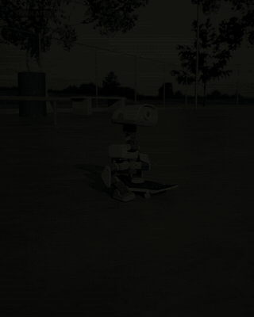 | 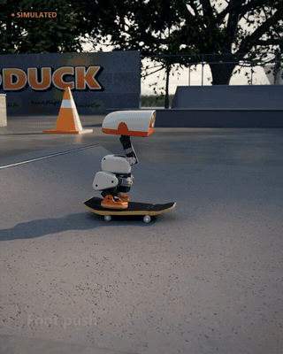 | 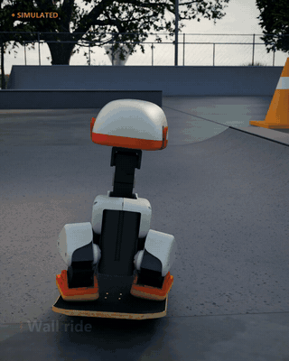 |

## How to run

Needs Python 3.12. Training needs an NVIDIA GPU; evaluation also runs on the CPU (slowly).

1. **Install [microduck_rl](https://github.com/pollen-robotics/microduck_rl)** at the tested commit, then this repo:

   ```bash
   git clone https://github.com/pollen-robotics/microduck_rl && cd microduck_rl
   git checkout bae39f5900b318f7e87fc485c30a31213cfa14eb && uv sync && cd ..
   git clone https://github.com/zumstein-jesse/micro-skater
   # either install it into microduck_rl's venv ...
   uv pip install --python microduck_rl/.venv -e micro-skater
   # ... or just put it on the path (the tested way):
   export PYTHONPATH=$PWD/micro-skater/src      # Windows: set PYTHONPATH=%CD%\micro-skater\src
   ```

   Use microduck_rl's venv Python for every command below, from the `micro-skater` folder.
2. **Evaluate the four-policy chain** with the released checkpoints, using the final eval's settings:

   ```bash
   python scripts/eval_chain.py --n 32 --seed 3                     # GPU; writes out/chain_final_s3/
   python scripts/eval_chain.py --cpu --n 4 --seconds 30 --no-render  # CPU check, about 4 minutes
   ```

   You get `funnel.json`, with how far each run got and the "complete" count, plus `demo_qpos.npz` and `model.mjb`
   (the Isaac renderer's input; also with `--no-render`). Without `--no-render` you also get MuJoCo videos
   (`chain_typical.mp4`, `chain_best.mp4`, `chain_demo.mp4`).
3. **Watch one policy** in mjlab's viewer, or record a MuJoCo video with `--video`:

   ```bash
   python -m micro_skater.play Mjlab-Skate-Flat-MicroDuck --checkpoint-file checkpoints/skater_v7f/model.pt
   ```

4. **Train.** One script per released policy (`train_p16`, `train_m6`, `train_r10`, `train_p17e`, `train_runner`,
   `train_v7f`) sets its run's env vars and resumes from the released checkpoint:

   ```bash
   python scripts/train_r10.py --smoke        # 64 envs, 5 iterations: check it builds
   python scripts/train_r10.py --dry-run      # print the env vars and the command
   python scripts/train_r10.py                # 500 more iterations at 2048 envs
   ```

Details: [docs/how_to_run.md](docs/how_to_run.md). The Isaac Sim renderer is in
[tools/isaac_render/](tools/isaac_render/); NVIDIA's scene assets are not included.

## Repo map

```
src/micro_skater/   tasks/ (task configs; the four phases' rewards are in skate_sequence.py and skate_seq_ramp.py,
                    the skater's and runner's in mdp.py), robot/ (boards, skate robot), actuator/ (servo realism),
                    eval/ (chain_play.py scheduler, sequence_eval.py), data/ (stance poses, hand-off banks)
scripts/            train_<policy>.py, eval_chain.py
checkpoints/        the 7 released policies (README inside)
docs/               early phases, rewards, training history, realism, how to run
media/              GIFs and two mp4s (MEDIA_SOURCES.md)
tools/              render_takes_mujoco.py, isaac_render/
```

## License

- **Code, docs and checkpoints:** [Apache-2.0](LICENSE), Copyright 2026 zumstein-jesse.
- **`media/`:** the renders show robot meshes licensed CC BY-NC-SA 4.0, so the media is CC BY-NC-SA 4.0. See
  [THIRD_PARTY_LICENSES.md](THIRD_PARTY_LICENSES.md).
- **Dependencies:** this repo depends on microduck_rl, mjlab, rsl_rl and MuJoCo but does not include them.
