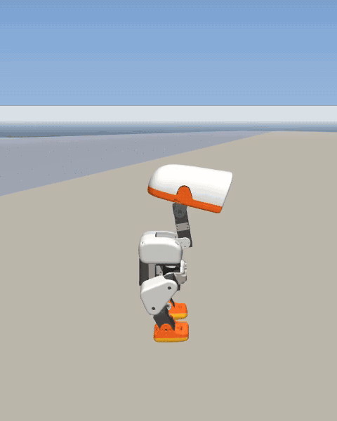
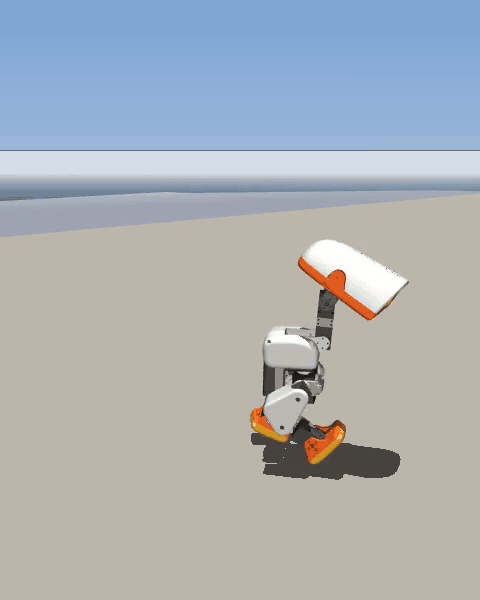
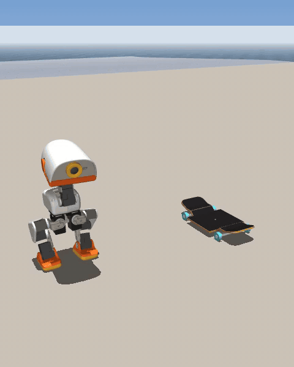
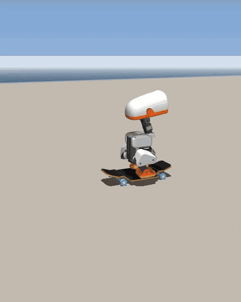
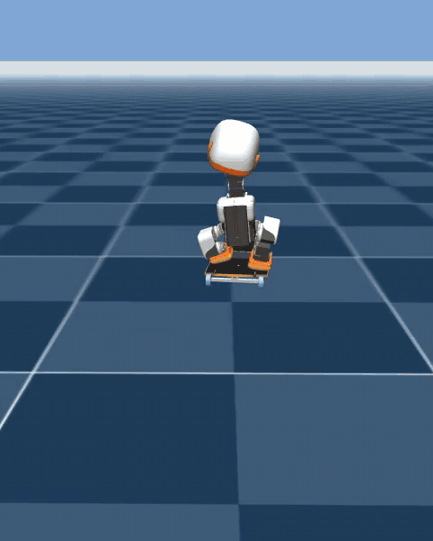
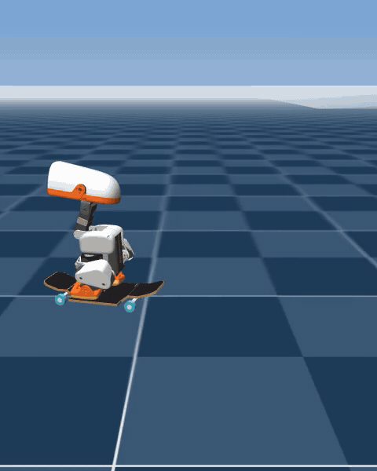
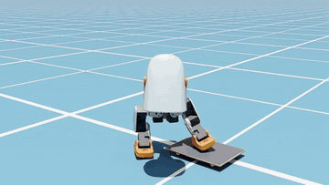
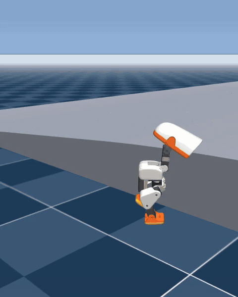
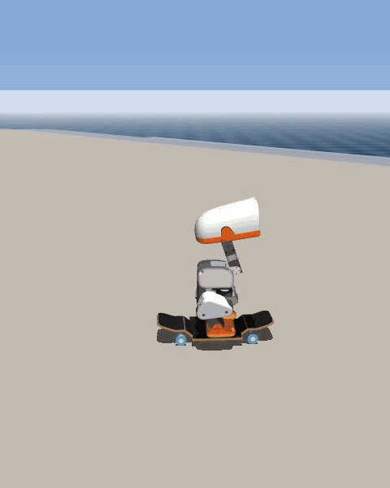
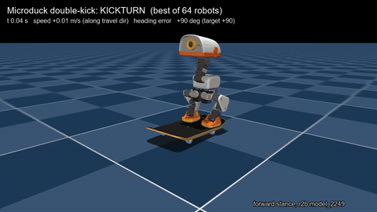

# Before the half-pipe: walking, running and the playable skater

← [back to README](../README.md)

The project went **walk → run → skate (mount, ride, dismount) → tricks → the 4-phase skate run**. This page covers the
early parts. All of it happened in simulation, between 2026-11-01 and 2026-11-07.

**What comes from where:**

| Part | Origin |
|---|---|
| Robot model, servo model integration, walking task and its rewards | [microduck_rl](https://github.com/pollen-robotics/microduck_rl) (the dependency this repo builds on). The walking policy in `checkpoints/walker/` was trained with microduck_rl's stock velocity task (`Mjlab-Velocity-Flat-MicroDuck`), unchanged |
| Get-up policy used in the play sim (VelStand) | a published microduck_rl policy, used as is; not included here |
| Running task, every skateboard task, the boards, the chain scheduler, the play sim and the video pipeline | this repo's author |

## 1. Walking (microduck_rl's stock task)

- **Task.** Follow a velocity command (forward/back speed, sideways speed and turn rate), plus head-pose commands.
- **Training.** 5000 PPO iterations, about 3 hours on one RTX 3090.
- **Policy.** 61 inputs, all from the robot's own sensors: IMU, joint angles and speeds, last action, command.
  14 joint targets out.

Main reward terms of that task, in plain words:

| Term | +/− | Purpose |
|---|---|---|
| Track linear / angular velocity | + | Go at the commanded speed and turn rate |
| Upright | + | Keep the trunk level |
| Pose | + | Stay near a natural pose (tight when standing, looser when walking) |
| Feet air time | + | Real steps of a reasonable length, not shuffling |
| Foot clearance / swing height | − | Lift the feet about 2 cm instead of dragging them |
| Foot slip | − | No sliding feet |
| Self-collisions | − | Legs not hitting each other |
| Body angular velocity / momentum | − | No wobbling |
| Action rate | − | Smooth commands to the servos |
| Head pose tracking | + | The head follows its own command |

These terms are microduck_rl's, not this repo's; its repository documents the reasoning behind them.

## 2. Running (the author's task)

The walker topped out at about 0.4 m/s, even when asked to go faster. Its speed reward was a wide bell curve, so
"roughly fast" paid almost as well as "actually fast". The extra effort didn't pay.

The task `Mjlab-Velocity-Run-Flat-MicroDuck` **keeps the walking recipe** and changes three things:

- forward commands go up to 1.0 m/s, and 35 % of commands are in a "run bucket" of 0.5–1.0 m/s;
- **run speed tracking** (+3): a *narrow* bell curve on forward speed, active only for run commands;
- **run yaw tracking** (+2), added in v2: run_v1 turned only 0.16–0.25 rad/s while running, against a 0.8 rad/s
  command.

It was **resumed from the walker**, not trained from scratch, so it keeps the walker's balance and style.

- **Result** (`run_v2`, iteration 6750): about 0.73 m/s at a 0.8 m/s command, about 0.45 rad/s turns while running,
  and 0 falls in 8 steered 20-second runs on flat ground.
- **Quirks:** it stalls at exactly a 1.0 m/s command. It has never seen slopes. Only about 19 % of its training
  commands were backward.

## 3. The playable skater (skate v1 → v7f)

The goal was a **keyboard-driven** simulation:

- walk up to a board, step on (**E**);
- push with **W**, and steer with **A/D**;
- step off (**Q**), then walk or run away (**Shift**).

It runs in CPU MuJoCo in real time. A small hand-written "director" switches between the walker, the runner and the
skater policy, and the get-up policy after a fall.

| Approach and mount (E) | Push (W) | Steer (A/D) | Dismount (Q) |
|---|---|---|---|
|  |  |  |  |

### The version story (one line each)

| Version | What changed | What happened / lesson |
|---|---|---|
| v1 | Kick-push task, warm-started from the walker | Paddled at about 6 Hz and never glided |
| v2 | Push-rhythm rewards | About 2.5 Hz pushes, still never glided, and the tiny board didn't read as a skateboard. Rejected |
| v3 | New cruiser board (22.4 × 11 cm, 20 mm wheels). A **mode machine** (PUSH → GLIDE → STOP) on filtered speed. Glide pays *more* per second than pushing | First real glides. A review caught a "fall forward" jackpot and a pump-and-brake exploit before they mattered |
| v4 | Steering as a **curvature** command; softer trucks | Rode straight; turns of about 2.4–3 m radius one way, weaker the other |
| v5 → v5d | Step on and step off | The robot **parked in the push stance** instead of stepping off. Fixed with a potential pulling both feet to spots beside the board, plus starts with the step-off flag already raised |
| v6a → v6g | Throttle/coast, tighter turns, a walk-up from anywhere near the board | Copying the walker's gait into the skater network wrecked the step-on. Fix: the **walker plus a small planner** walks the robot up, then hands over to the skater. Turning was limited by hip-roll joints parked at their stops as a brace |
| v7 → v7f | Higher speeds (up to about 1.4 m/s with W held) and slopes (training tilts gravity per environment) | Downhill rides worked. **Pushing uphill and turning on slopes stayed weak.** The fall line is a stable heading |

The play sim used **v7f, iteration 4350** (`checkpoints/skater_v7f/`). The GIFs on this page are MuJoCo re-renders of
recorded play-sim sessions (`tools/render_takes_mujoco.py`). In the push clip the robot rolls down one of the play
park's ramps onto the floor. The keyboard play sim itself is not in this repo yet (TODO).

**Bloopers that taught something:**

- **v2 (right):** pushing constantly but never gliding. Rewarding speed alone doesn't create a glide; the glide has to
  pay more than pushing.
- **Walls and edges** (below): the walking and running policies never saw a wall or an edge in training, so they
  walk straight into the side of the platform, and the skater rolls over its edge without slowing down.
- **Pushing uphill on a 3° slope** failed in the CPU play sim nearly every time. That is why the play park only has
  downhill ramps.

| Walker vs. platform wall | Skater vs. platform edge |
|---|---|
|  |  |

## 4. Side quests that shaped the final project

- **A real-sensor student** for the playable skater was trained without board or contact sensors, only things the
  robot can measure plus a planned "smart board". It came close to the teacher on several tests, but lost on mounting
  and steering. It is **not** part of the 4-phase run, whose policies are still teacher-only, and it is not released.
- **The manual on the first board was impossible.** The ends were too narrow for the feet and there is no ankle roll
  joint. A training attempt (m1) learned only a safe refusal. That led to wider boards.
- **A double-kick trick board** (2026-11-19) got a forward-stance policy doing manuals, kick-turns and tic-tacs in
  simulation (below: a kick-turn, MuJoCo view). That policy **warm-started** the 4-phase sequence: its observations
  were extended from 101 to 114 numbers.

